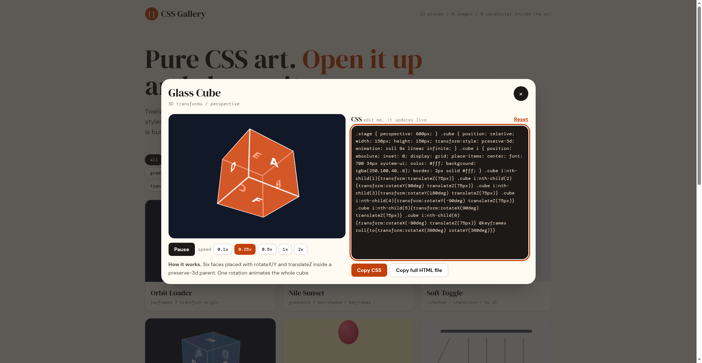

# CSS Gallery

Twelve pieces of pure CSS art you can open, edit and copy.

**Live demo:** https://malakmo7amed309.github.io/css-gallery/



## Standout feature

Every piece opens in a studio with its real stylesheet in an editor. Change a value and the artwork updates live. A speed control (0.1x to 2x) and a pause button use the Web Animations API, so you can slow an animation down and see how it is built. Copy the CSS or a complete HTML file.

## Pieces

Orbit loader, Nile sunset, soft toggle, glass cube, squash ball, Newton's cradle, Giza at night, typewriter, glitch text, burger menu, heartbeat, aurora border. Filter them by technique (keyframes, clip-path, :checked, @property and more). Each piece links by hash, for example `#cube`.

## Stack

Preact, Vite, Tailwind. The art itself is plain HTML and CSS rendered in sandboxed iframes with scripts off.

## Develop

```
npm install
npm run dev
npm run build
```

The single-file build is in `docs/` and is served by GitHub Pages.
